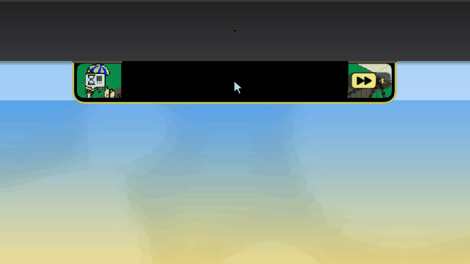
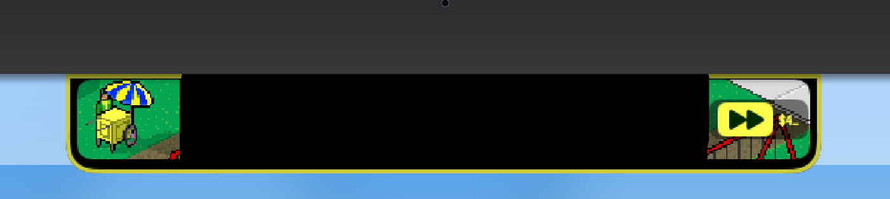
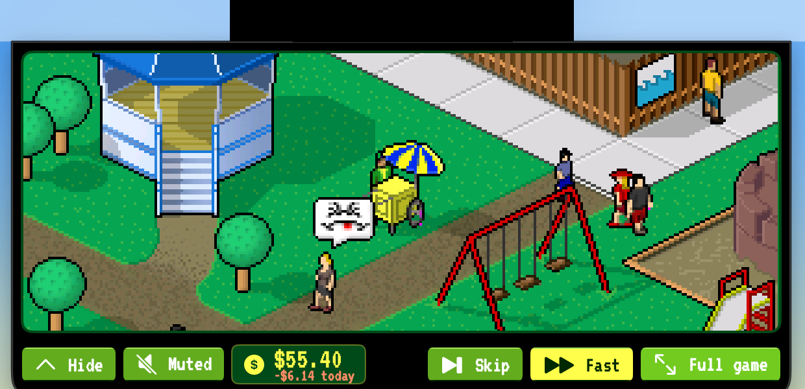
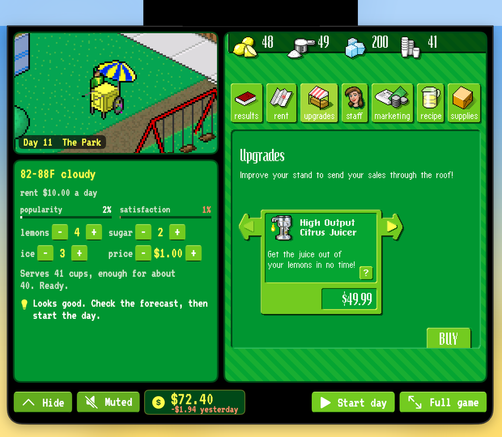
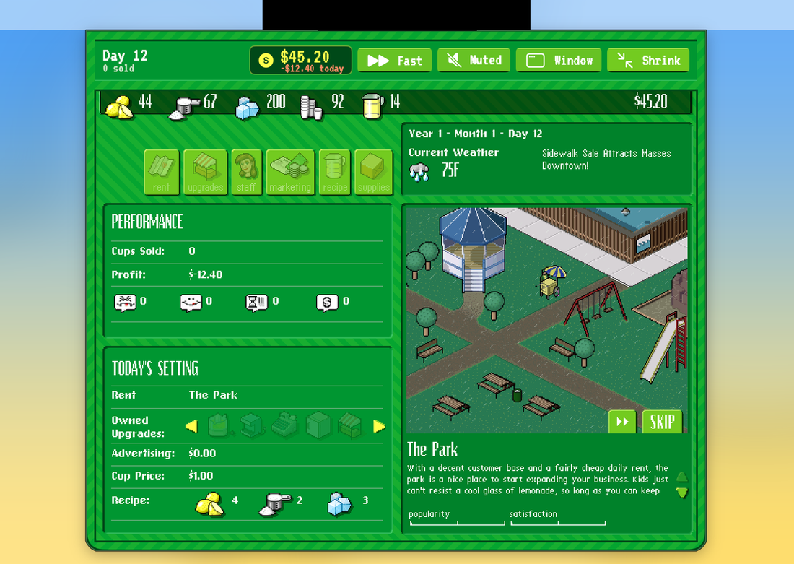
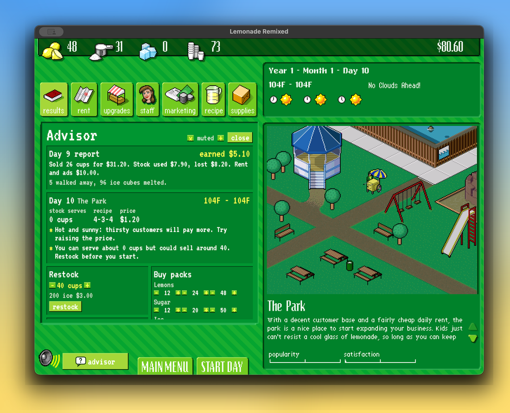

# Lemonade Remixed

Lemonade Remixed runs the original 2002 **Lemonade Tycoon Deluxe** (Hexacto)
unchanged inside a native Mac app, and puts your lemonade stand in the MacBook
notch. The game's own code, art and sound do the work. The app adds a sharp
picture at any size, sound controls, an in-game Advisor, and a notch you can
glance at, open, and play from while you work.

**AI disclosure:** Lemonade Remixed uses substantial AI assistance for code,
tests, documentation, debugging and maintenance. There is no audited percentage
of AI-generated code; the testing status below states what has actually been
checked. This describes Lemonade Remixed's workflow, not the authorship of the
original game.

<p align="center">
  
</p>

<p align="center">
  <strong>Lemonade Tycoon, in your Mac's notch.</strong><br>
  The original game, sharp at any size. Your own copy. No Wine windows, ever.
</p>

<p align="center">
  
  
  
  
  
  
  
  
</p>

<p align="center">
  <a href="#the-notch">The notch</a> ·
  <a href="#get-the-game">Get the game</a> ·
  <a href="#build-and-play">Build and play</a> ·
  <a href="#what-it-adds">What it adds</a> ·
  <a href="#testing-status">Testing status</a> ·
  <a href="#how-it-works">How it works</a>
</p>

<p align="center">
  
</p>

> [!IMPORTANT]
> **Lemonade Remixed doesn't include the game.** You build the app from source
> on your own Mac and bring your own copy of the original installer; the app
> unpacks it on your machine. Nothing from the original game is committed or
> distributed here, and there is no prebuilt download yet.

## The notch

On a MacBook with a notch, the game lives at the top of your screen. It keeps
running in every view, and the notch and the game window take turns showing it.

**Closed.** Your stand, live, on the left of the notch. On the right, the street
carries on with your cash and today's sales taking turns. During a day, click
the right side to fast-forward; a lemon outline ties both sides together.

<p align="center"></p>

**Small view.** Click the notch and the game drops down. While you sell, it's
the live street around your cart, with your cash, Skip, Fast and Full game.
It stays open while you work in other apps.

<p align="center"></p>

**Planning.** Before a day, the small view becomes a planner beside the game's
own tabs: forecast and rent, popularity and satisfaction, recipe and price,
one-click restock and the Advisor's tip on the left; rent, upgrades, staff,
marketing, recipe, supplies and results on the right, clickable at full
sharpness. When the game asks a question, you answer it right there.

<p align="center"></p>

**Full game.** The whole game at 1×, hanging from the notch. Click anywhere
else, or press Esc, and it shrinks back to the small view.

<p align="center"></p>

Closing the game window with the notch on keeps the game running in the notch;
⌘Tab or the Dock icon brings the window back. On a Mac without a notch, the
same strip sits at the top centre as a pill. You can turn the notch off in
**Settings** (⌘,).

## Get the game

1. Download **Lemonade Tycoon Deluxe** (the Zone.com edition) from the
   abandonware archive at [Old Games Download](https://oldgamesdownload.com/lemonade-tycoon/).
   [My Abandonware](https://www.myabandonware.com/game/lemonade-tycoon-c4f) also lists it.
   Neither site is connected to this project, and the game's rights belong to
   their owners.
2. Unzip it. You need `Setup.exe` and the registration name and key in its `readme.txt`.

The app checks the installer's SHA-256 before using it. The same links are in
the app under **Help ▸ Where to Get the Game**.

## Build and play

| Need | Notes |
|---|---|
| A Mac with macOS 14 or later | Tested on Apple Silicon, where Wine runs the game through Rosetta 2. Intel builds are untested. |
| Xcode command-line tools | For `swift build`. |
| [Wine Stable](https://github.com/Gcenx/macOS_Wine_builds) | `brew install --cask wine-stable`; the build copies it into the app. |
| LLVM | `brew install llvm`; builds the small in-game agent (sound and picture). |

```sh
git clone https://github.com/chrissotraidis/lemonaderemixed.git
cd lemonaderemixed
mac/bundle.sh          # builds mac/build/Lemonade Remixed.app
open "mac/build/Lemonade Remixed.app"
```

On first launch, choose `Setup.exe` and enter the name and key. The game
installs into the app's own folder in Application Support in about 20 seconds
and goes straight to the main menu. Saves stay there across updates.

## What it adds

<p align="center"></p>

| Feature | What you get |
|---|---|
| The notch | Your stand live in the menu bar, a small view you can plan and sell from, and the full game one click away. |
| Sharp picture | Crisp game pixels at any window size or full screen, from a frame tap inside the game (no screen recording). **Pixel-Perfect** (⌘2) keeps whole-number scaling. |
| Wine out of sight | Wine runs headless: no Wine windows, Dock icons or file-access prompts. |
| Sound | **Mute** (⌘M) and 25–100% volume, saved between launches. |
| Advisor | A game-style button beside the speaker opens a panel over the game's own left panel: morning tips from the forecast, buying several packs at once with no pop-ups, saved recipes, one-click restock and an end-of-day summary. |
| Settings (⌘,) | Notch on or off, sound and picture, and where to get the game. |

Every action goes through the game's own interface, so the rules are exactly
the original's.

## Testing status

| Area | Status |
|---|---|
| Install from your own `Setup.exe`, registration, launch, saves | Played by the maintainer on an Apple Silicon MacBook (macOS 26). |
| Sharp picture, window, full screen, sound controls | Played by the maintainer. |
| Advisor and quality-of-life features | Played by the maintainer. |
| Notch: closed, small view, planning, full game | Played daily by the maintainer on a MacBook with a notch. |
| Macs without a notch (the pill) | Checked by simulating a notchless screen; not yet seen on a real notchless Mac or an external display. |
| Intel Macs, macOS 14 and 15 | Not tested. |
| macOS 28 | Unknown. The bundled Wine is Intel code that runs through Rosetta 2, which Apple scales back after macOS 27; see [G10 in GOALS.md](docs/GOALS.md#g10-ship). |
| Widget, prebuilt download, iPhone and iPad | Planned; see [docs/GOALS.md](docs/GOALS.md). |

## How it works

- [tools/unpack_installer.py](tools/unpack_installer.py) and
  `RemixCore.InstallerArchive` unpack the original VISE installer and check every
  file against the CRC-32 it records.
- [runtime/helper](runtime/helper) is a small Windows Python program inside Wine.
  It launches the game, reads its state from fixed memory addresses
  ([docs/STATE.md](docs/STATE.md)) and clicks through its interface for the
  app's actions, over a local connection.
- [runtime/agent](runtime/agent) stands in for the game's sound library. It
  applies the app's volume and copies each finished frame to a shared file that
  the app draws with Metal.
- [mac](mac) is the Swift app: the window, the Advisor, the notch and Settings.

## Documents

- [docs/GOALS.md](docs/GOALS.md): the build plan as goals, each with its test.
- [docs/MECHANICS.md](docs/MECHANICS.md): how the original game works, with the numbers measured so far.
- [docs/PLAN.md](docs/PLAN.md): what the remix adds and why.
- [docs/STATE.md](docs/STATE.md): where the game keeps its state in memory.
- [docs/ORIGINAL.md](docs/ORIGINAL.md): running the original under Wine for reference.

## License, credits and legal

Lemonade Remixed's own code is released under the [GNU GPL v3](LICENSE).

*Lemonade Tycoon* is a trademark of its owners. Lemonade Remixed isn't
affiliated with them and doesn't include the game; the screenshots above show
the original game running in the app. The build bundles
[Wine](https://www.winehq.org) (LGPL, via Gcenx's macOS builds), the embeddable
Windows [Python](https://www.python.org) (PSF License) and the
[VT323](https://fonts.google.com/specimen/VT323) font (SIL Open Font License).
The app icon is original artwork.
