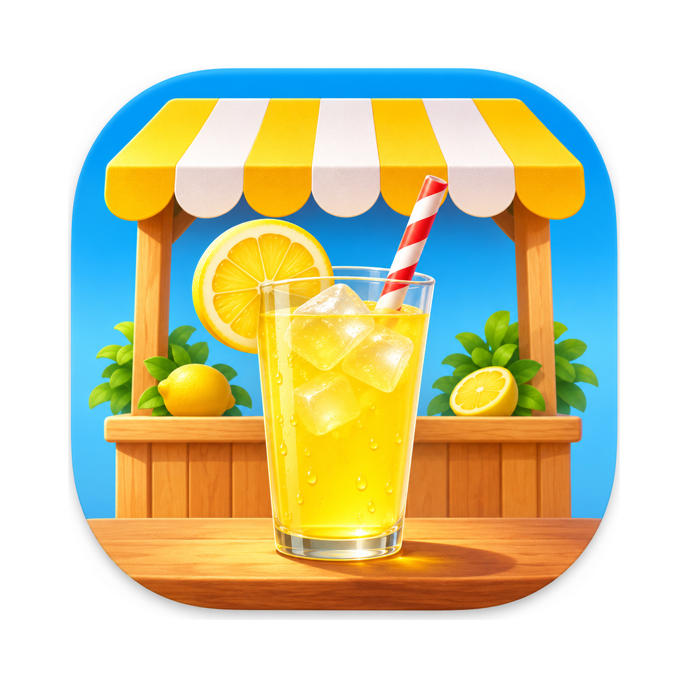

# Lemonade Remixed

Lemonade Remixed runs the original 2002 **Lemonade Tycoon Deluxe** (Hexacto) unchanged
inside a native Mac app. The game's own code, art and sound do the work; the app
adds a sharp picture at any size, sound controls, an in-game Advisor with
quality-of-life shortcuts, and a mode that lets you run your stand from the
MacBook notch while you work.

**AI disclosure:** Lemonade Remixed uses substantial AI assistance for code,
tests, documentation, debugging and maintenance. There is no audited percentage
of AI-generated code; the status below states what has actually been checked.
This describes Lemonade Remixed's workflow, not the authorship of the original
game.

<p align="center">
  
</p>

<p align="center">
  <strong>Lemonade Tycoon Deluxe, native on the Mac and in the notch.</strong><br>
  The original game, sharp at any size. Your own copy. No Wine windows, ever.
</p>

<p align="center">
  
  
  
  
  
  
  
</p>

<p align="center">
  <a href="#get-the-game">Get the game</a> ·
  <a href="#build-and-play">Build and play</a> ·
  <a href="#what-it-adds">What it adds</a> ·
  <a href="#the-notch">The notch</a> ·
  <a href="#testing-status">Testing status</a> ·
  <a href="#how-it-works">How it works</a>
</p>

> [!IMPORTANT]
> **There is no download yet.** Lemonade Remixed is a preview you build from
> source on your own Mac. It doesn't include the game: you supply the original
> installer yourself, and the app unpacks it on your machine. Nothing from the
> original game is committed or distributed here.

## Get the game

1. Download **Lemonade Tycoon Deluxe** (the Zone.com edition) from the
   abandonware archive at [Old Games Download](https://oldgamesdownload.com/lemonade-tycoon/).
   [My Abandonware](https://www.myabandonware.com/game/lemonade-tycoon-c4f) also lists it.
   Neither site is connected to this project, and the game's rights belong to
   their owners.
2. Unzip it. You need `Setup.exe` and the registration name and key in its `readme.txt`.

The app checks the installer's SHA-256 before using it. The same links are in
the app under **Help ▸ Where to Get the Game**.

## Build and play

| Need | Notes |
|---|---|
| A Mac with macOS 14 or later | Tested on Apple Silicon, where Wine runs the game through Rosetta 2. Intel builds are untested. |
| Xcode command-line tools | For `swift build`. |
| [Wine Stable](https://github.com/Gcenx/macOS_Wine_builds) | `brew install --cask wine-stable`; the build copies it into the app. |
| LLVM | `brew install llvm`; builds the small in-game agent (sound and picture). |

```sh
git clone https://github.com/chrissotraidis/lemonaderemixed.git
cd lemonaderemixed
mac/bundle.sh          # builds mac/build/Lemonade Remixed.app
open "mac/build/Lemonade Remixed.app"
```

On first launch, choose `Setup.exe` and enter the name and key. The game
installs into the app's own folder in Application Support, in about 20
seconds, and goes straight to the main menu. Saves stay there across updates.

## What it adds

| Feature | What you get |
|---|---|
| Sharp picture | Crisp game pixels at any window size or full screen, from a frame tap inside the game (no screen recording). **Pixel-Perfect** (⌘2) keeps whole-number scaling. |
| Wine out of sight | Wine runs headless: no Wine windows, Dock icons or file-access prompts. |
| Sound | **Mute** (⌘M) and 25–100% volume, saved between launches. |
| Advisor | A game-style button beside the speaker opens a panel over the game's own left panel: morning tips from the forecast, buying several packs in one go with no pop-ups, saved recipes, one-click restock and an end-of-day summary. |
| Settings (⌘,) | Notch on or off, sound and picture, and where to get the game. |

Every action goes through the game's own interface, so the rules are exactly
the original's.

## The notch

On a MacBook with a notch, the game also lives at the top of the screen. It
keeps running in every state, and the game window and the notch take turns
showing it.

- **Closed:** your stand, live, left of the notch, with a lemon outline joining
  both sides. On the right, the street goes on with your cash and today's
  numbers taking turns; during a day, clicking there toggles fast-forward.
- **Small view** (click the notch): while selling, the live street around your
  cart with Skip day and Fast. While planning, a quick plan (recipe, price,
  restock, tips) beside the game's own tabs and panel, clickable at full
  sharpness, so rent, upgrades, staff, marketing and supplies all work from
  here. The game's questions can be answered in place.
- **Full game:** the whole game at 1×, playable. Clicking elsewhere or Esc
  shrinks it back to the small view.

Closing the game window with the notch on keeps the game running in the notch;
⌘Tab or the Dock icon brings it back.

## Testing status

| Area | Status |
|---|---|
| Install from your own `Setup.exe`, registration, launch, saves | Played by the maintainer on an Apple Silicon MacBook, 5 November 2026. |
| Sharp picture, window, full screen, sound controls | Played by the maintainer. |
| Advisor and quality-of-life features | Played by the maintainer. |
| Notch (closed, small view, full game) | In active development and daily use by the maintainer; layout still changing. |
| Macs without a notch | Not yet: a pill at the top centre is planned. |
| Intel Macs, other macOS versions | Not tested. |
| Higher-resolution art | Parked: the original art looks good drawn sharp. |
| Widget, DMG download, iPhone and iPad | Planned; see [docs/GOALS.md](docs/GOALS.md). |

## How it works

- [tools/unpack_installer.py](tools/unpack_installer.py) and
  `RemixCore.InstallerArchive` unpack the original VISE installer and check every
  file against the CRC-32 it records.
- [runtime/helper](runtime/helper) is a small Windows Python program inside Wine.
  It launches the game, reads its state from fixed memory addresses
  ([docs/STATE.md](docs/STATE.md)) and clicks through its interface for the
  app's actions, over a local connection.
- [runtime/agent](runtime/agent) is a stand-in for the game's sound library. It
  applies the app's volume and copies each finished frame to a shared file the
  app draws with Metal.
- [mac](mac) is the Swift app: the window, the Advisor, the notch and settings.

## Documents

- [docs/GOALS.md](docs/GOALS.md): the build plan as goals, each with its test.
- [docs/MECHANICS.md](docs/MECHANICS.md): how the original game works, with the numbers measured so far.
- [docs/PLAN.md](docs/PLAN.md): what the remix adds and why.
- [docs/STATE.md](docs/STATE.md): where the game keeps its state in memory.
- [docs/ORIGINAL.md](docs/ORIGINAL.md): running the original under Wine for reference.

## Credits and legal

*Lemonade Tycoon* is a trademark of its owners. Lemonade Remixed isn't
affiliated with them and doesn't include the game. It bundles
[Wine](https://www.winehq.org) (LGPL, via Gcenx's macOS builds), the embeddable
Windows [Python](https://www.python.org) (PSF License) and the
[VT323](https://fonts.google.com/specimen/VT323) font (SIL Open Font License).
The app icon is original artwork.
